# Codespace passo a passo, com as telas

Para quem nunca abriu um Codespace. Segue a mesma numeração do
[guia do Codespace](guia_codespace.md)
e mostra, tela a tela, onde clicar e o que esperar. Telas capturadas num teste real em 13/10/2026: o
GitHub e o Claude Code mudam de aparência com frequência, então o texto dos botões pode variar um pouco.

**Como ler as imagens:** caixa **vermelha** é onde clicar ou o que conferir (o número indica a ordem);
caixa **amarela com "!"** é o que evitar.

**Tempo total:** cerca de 15 minutos, dos quais uns 5 são espera enquanto o Codespace é montado. Faça
antes da Aula 1.

---

## 1. Conta no GitHub (todos do grupo)

Sem telas aqui: crie a conta em https://github.com/signup, mande o seu usuário para o operador e aceite
o convite que chega por e-mail (vale 7 dias).

## 2. Criar o repositório do grupo (operador, uma vez)

Entre em https://github.com/franciscojunqueira/fiap-ea-genai-lab e clique no botão verde
**Use this template**.

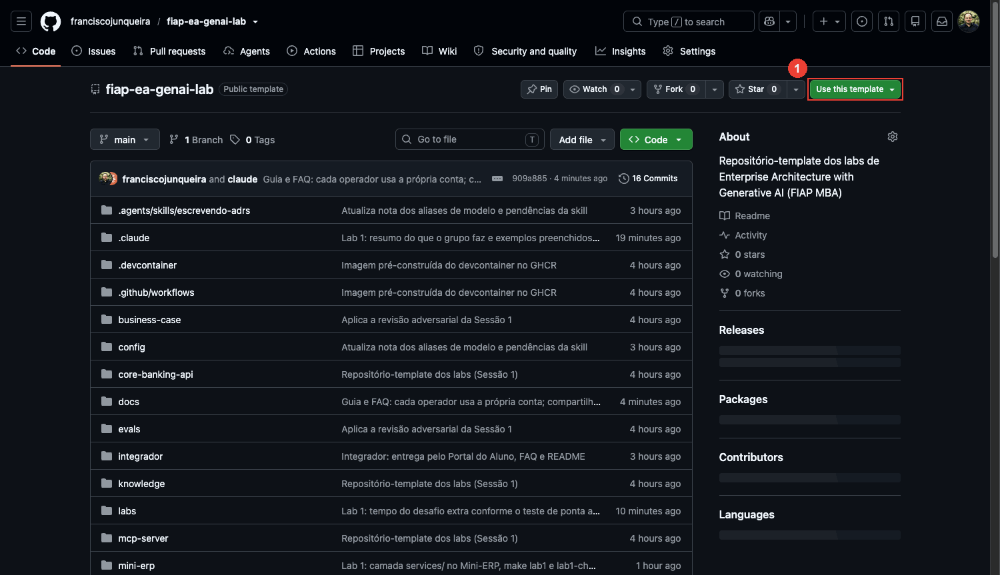

No menu que abre, escolha **Create a new repository**. **Não** use *Open in a codespace* (amarelo):
ele abre um Codespace no repositório do professor, não no do grupo, e o trabalho não fica salvo para
o grupo.

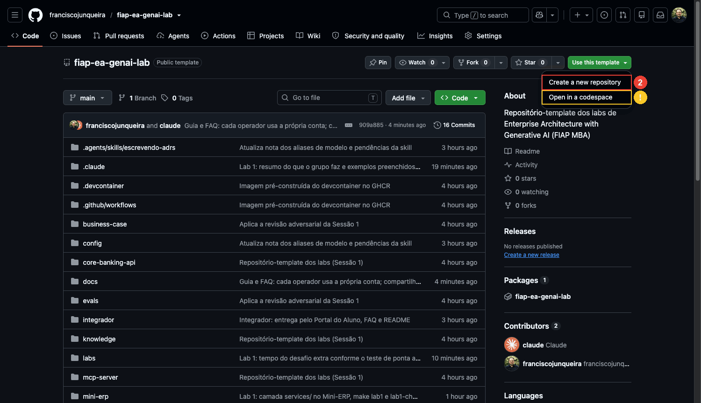

No formulário:

1. **(3)** Em *Repository name*, digite `ea-genai-grupo-N` (N = número do seu grupo).
2. **(4)** Em *Choose visibility* vem marcado **Public**. Clique e troque para **Private**: a entrega
   exige repositório privado.
3. **(5)** Clique em **Create repository**.

Deixe *Include all branches* desligado, como já vem.

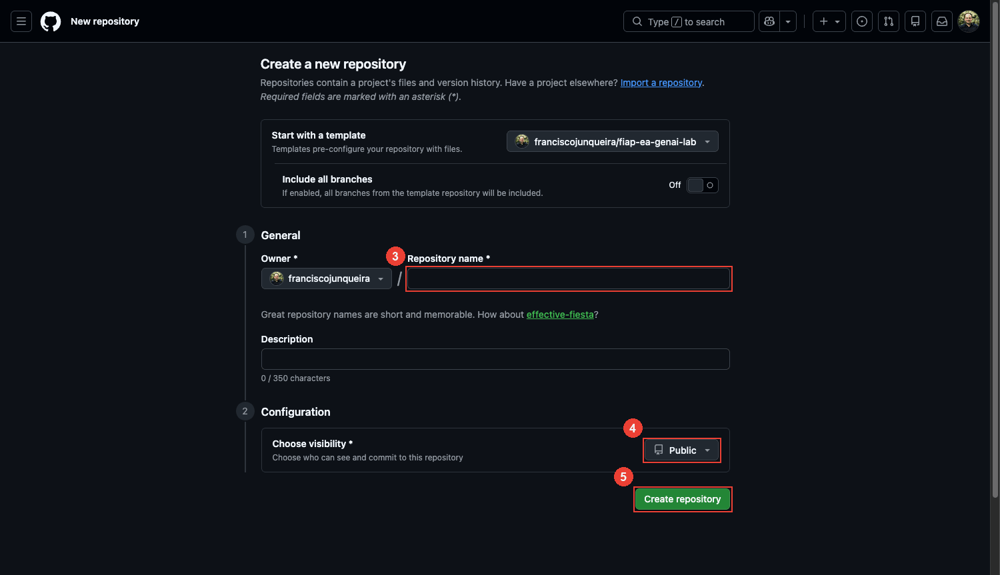

Depois, adicione os colegas e o professor em **Settings → Collaborators → Add people** (passo 2.5 do
guia do Codespace).

## 3. Criar o Codespace (operador e segundo assinante, uma vez)

No repositório **do grupo**, clique em **Code (1)** e depois na aba **Codespaces (2)**.

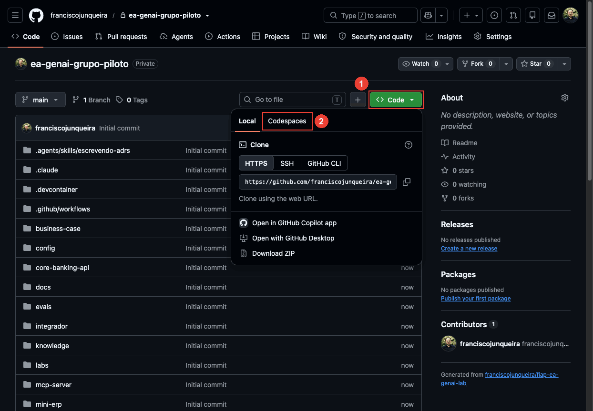

Clique em **Create codespace on main (3)**.

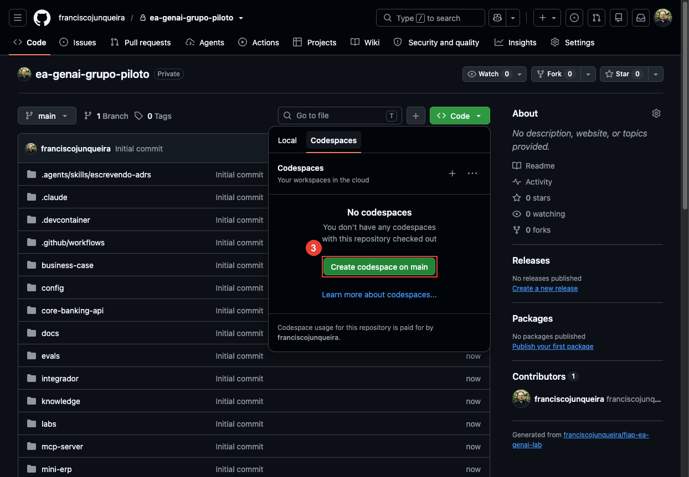

Abre uma aba nova com um editor parecido com o VS Code. No canto de baixo aparece
*Setting up remote connection: Building codespace...*. **Espere e não feche a aba**: no teste,
levou cerca de 4 minutos.

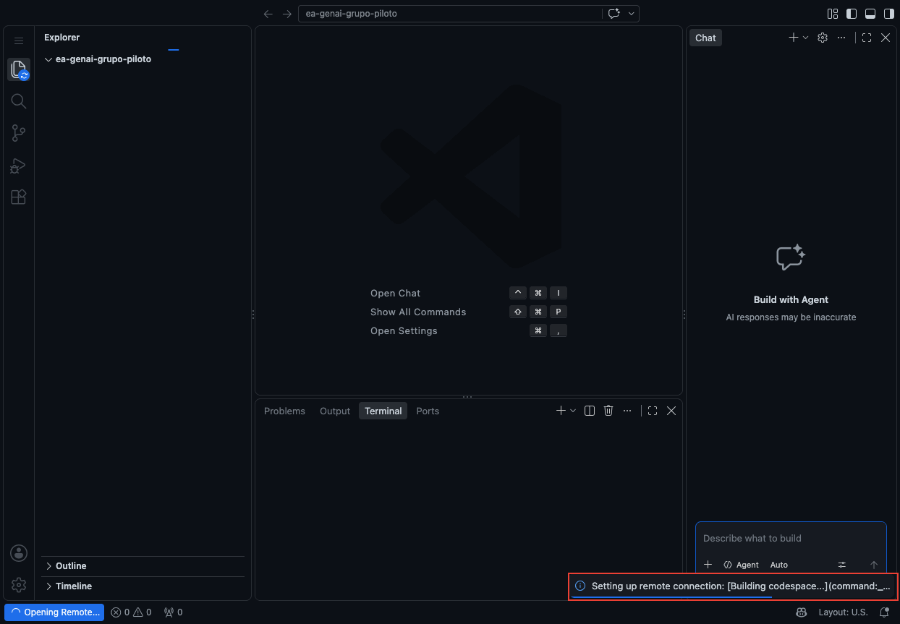

Quando o Codespace fica pronto, aparece a pergunta **"Do you trust the authors of the files in this
folder?"**. O repositório é do seu grupo: clique em **Trust Folder & Continue**. Sem isso o terminal
não abre e o editor fica em *Restricted Mode*.

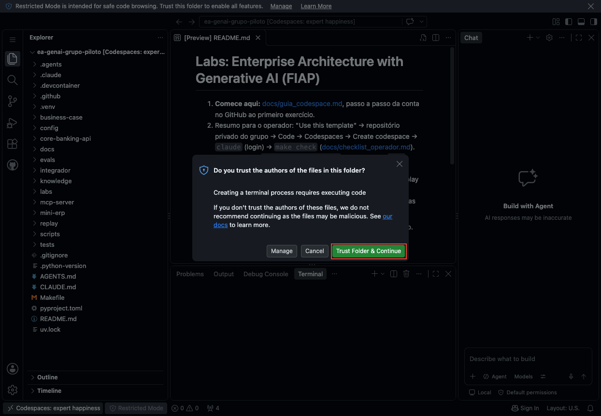

O terminal aparece embaixo com uma mensagem de boas-vindas. **A saída do `make check` não aparece
sozinha**: ela fica num log interno. Clique no terminal e confira você mesmo (próxima imagem).

Repare também no painel **Chat** à direita (amarelo). É o assistente do próprio GitHub (Copilot),
**não é o Claude Code** e não é usado no curso. Pode fechar no **X** do canto: sobra mais espaço para o
terminal e para a aba **Ports**.

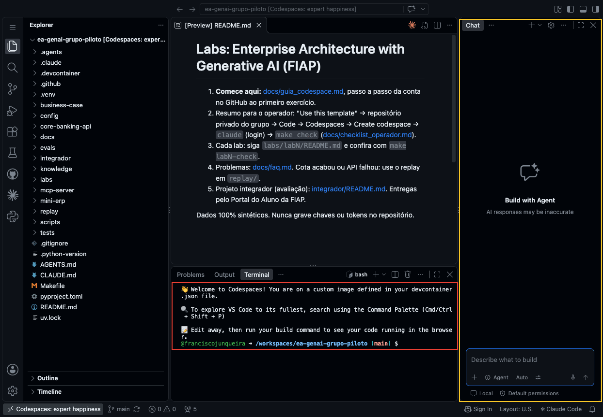

Clique no terminal, digite `make check` e tecle **Enter**. Nesta primeira vez o esperado é:
`[AVISO] Agente de código instalado, sem login` e `== PASS: 3 ok, 1 aviso(s), 0 falha(s) ==`. O
aviso some no passo 5.

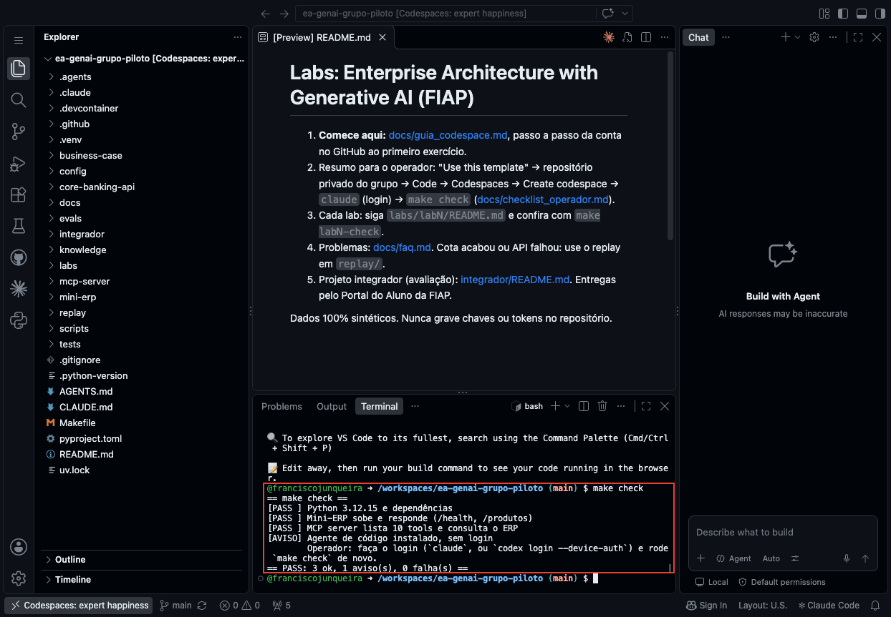

## 4. Conhecer a tela

| Área | Onde fica | Para quê |
|---|---|---|
| Explorador de arquivos | à esquerda | abrir os arquivos do repositório |
| Editor | no centro | ler e editar arquivos; um clique num `.md` abre o texto formatado |
| Terminal | embaixo | digitar os comandos (`make ...`, `claude`) |
| Maximizar o terminal | ícone de quadrado no canto direito do terminal | ler saídas longas; clique de novo para voltar |
| Aba **Ports** | ao lado da aba Terminal (ou no menu "⋯" se a janela estiver estreita) | abrir o Mini-ERP no navegador |

## 5. Fazer login no Claude Code (operador e segundo assinante, uma vez)

Cada um entra com a **própria conta**: compartilhar login é proibido pelos termos da Anthropic e da
OpenAI.

No terminal, digite `claude` e tecle Enter. A primeira tela pergunta o tema de cores: tecle **Enter**
para aceitar.

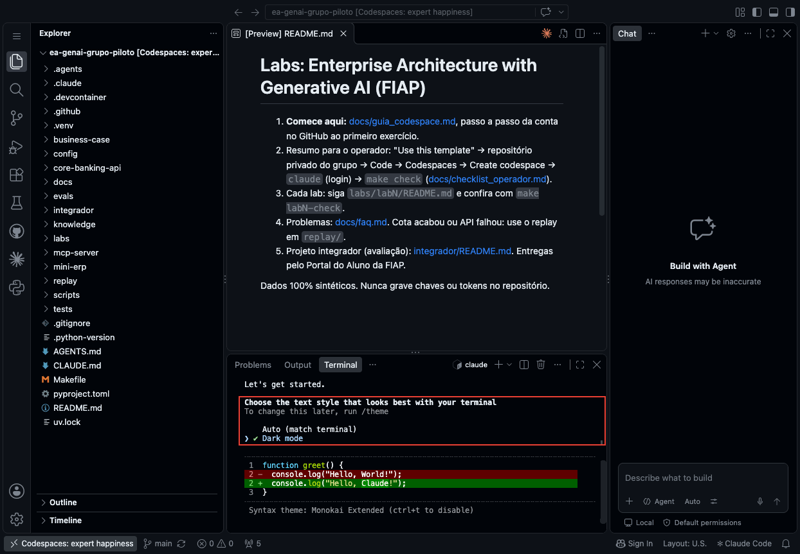

Tipo de login: a opção 1, **Claude account with subscription**, já vem marcada. Tecle **Enter**.

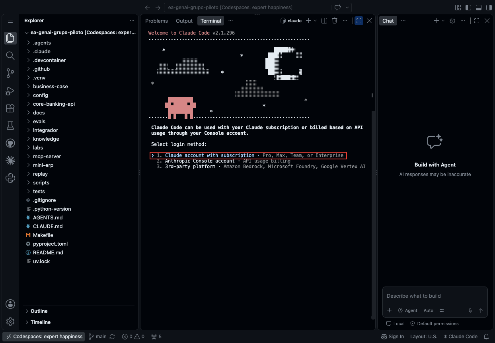

O editor mostra sozinho a pergunta **"Do you want Code to open the external website?"**. Neste primeiro
aviso, clique em **Cancel**. Se clicar em *Open* (amarelo), o navegador tenta voltar para
`localhost`, que só existe dentro do Codespace, e mostra *"localhost refused to connect"*. Se isso
acontecer, sem problema: feche essa aba e continue abaixo.

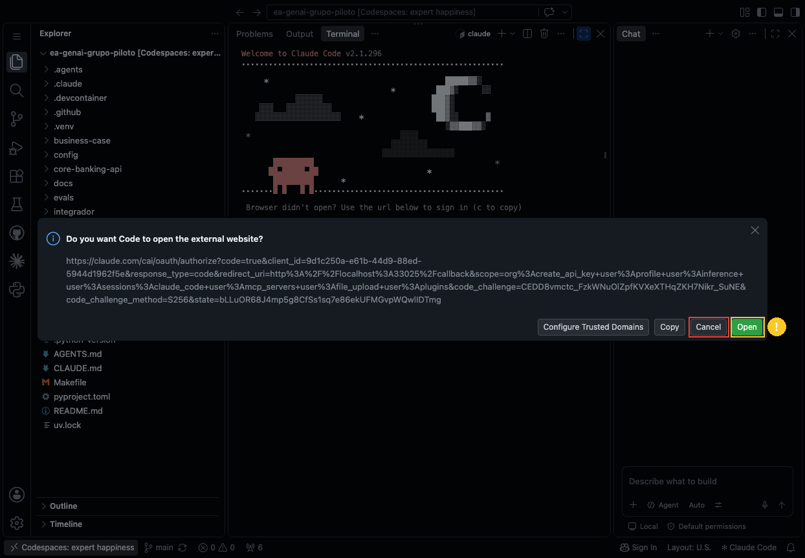

No terminal aparece um link longo **(1)** e, embaixo, *Paste code here if prompted* **(3)**. Segure
**Cmd** (Mac) ou **Ctrl** (Windows) e clique no link.

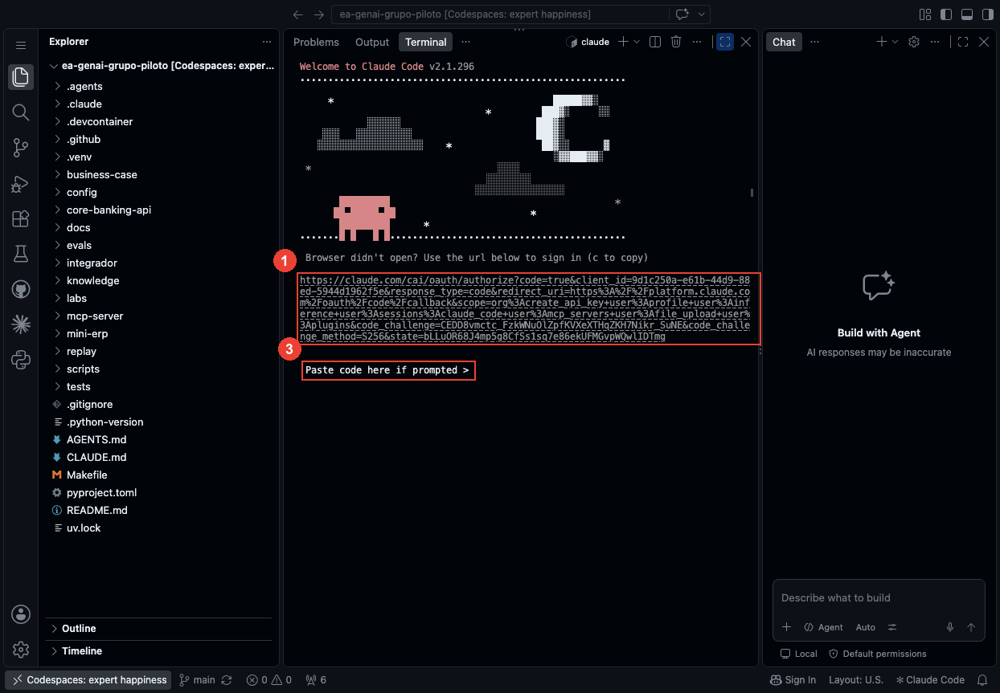

O editor pergunta de novo se pode abrir o site. Desta vez, clique em **Open (2)**.

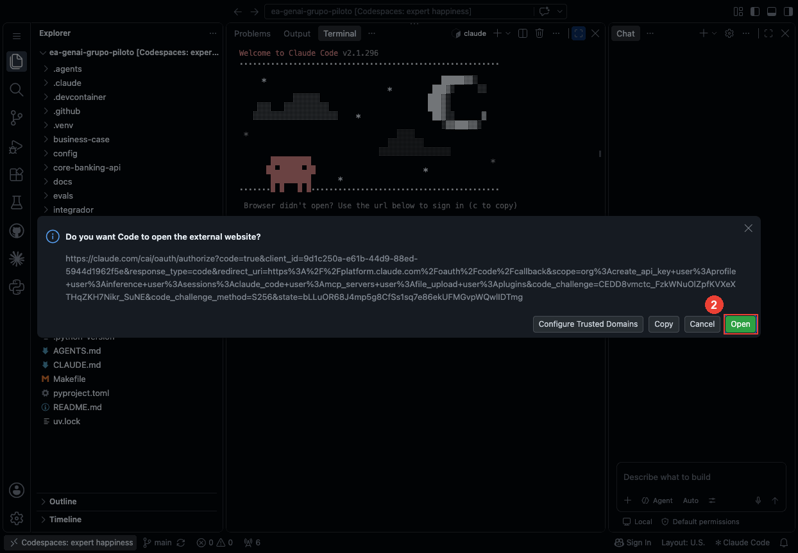

Abre a página da Anthropic (faça login, se ela pedir). **Antes de autorizar, confira o e-mail em
"Logged in as"**, no rodapé: tem de ser a **sua** conta com plano. Se for outra, use *Switch account*.
Então clique em **Authorize**.

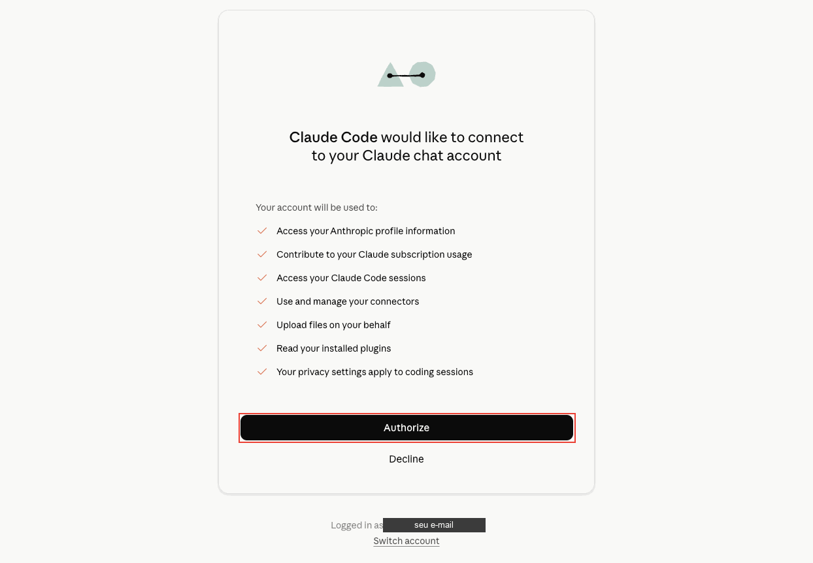

A página seguinte mostra **Authentication code** e o botão **Copy code** (pode haver um aviso de
cookies por cima; aceite ou recuse, tanto faz). Clique em **Copy code**, volte à aba do Codespace,
clique no terminal, cole com **Cmd+V** (ou **Ctrl+V**) em *Paste code here if prompted* e tecle
**Enter**. Se o navegador perguntar se pode colar, permita.

Aparece **Login successful**. Tecle **Enter**.

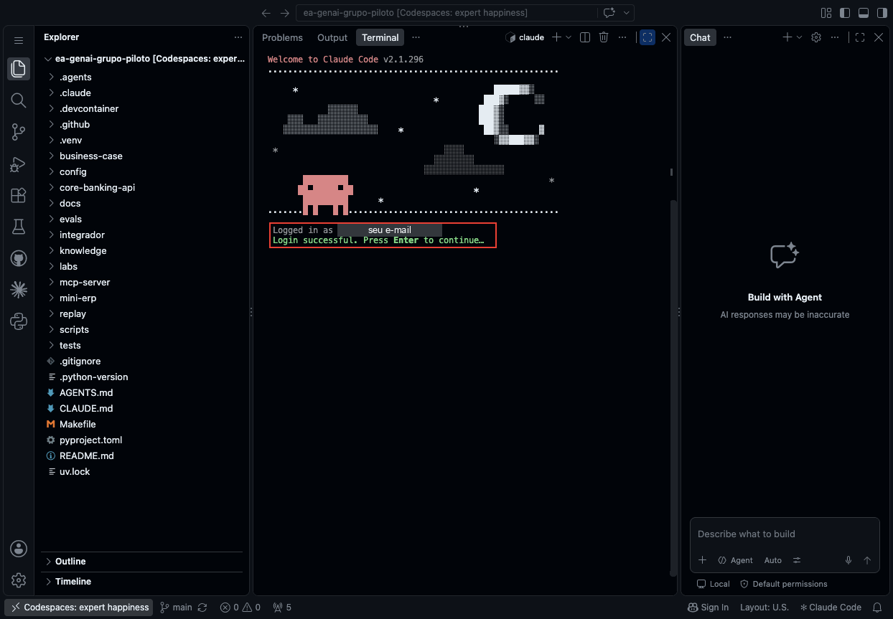

Mais três telas, todas com **Enter**, **menos a última**:

*Security notes*: tecle **Enter**.

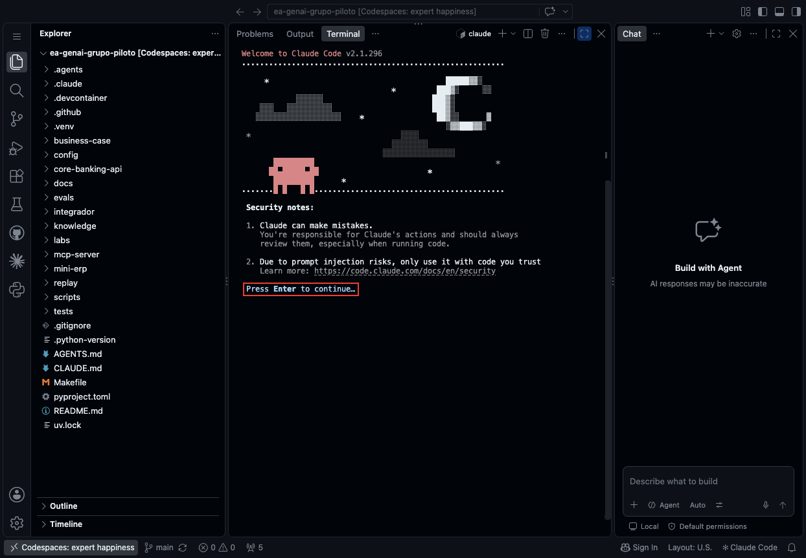

*Use Claude Code's terminal setup?*: tecle **Enter** (aceita o recomendado).


*Accessing workspace*: **atenção, aqui a opção marcada é "No, exit" (amarelo)**. Se teclar Enter
direto, o Claude Code fecha. Desça com a **seta para baixo** até **Yes, I trust this folder** e só
então tecle **Enter**.

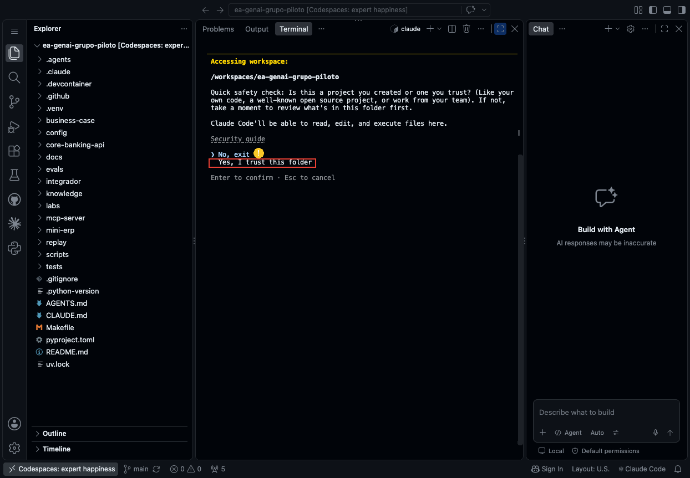

O Claude Code abre e mostra a caixa de digitação com o símbolo `❯`. No alto aparecem a versão, o
modelo e o plano (na sua conta aparece o seu plano, por exemplo *Claude Pro*). Digite `/exit` e tecle
Enter para sair.

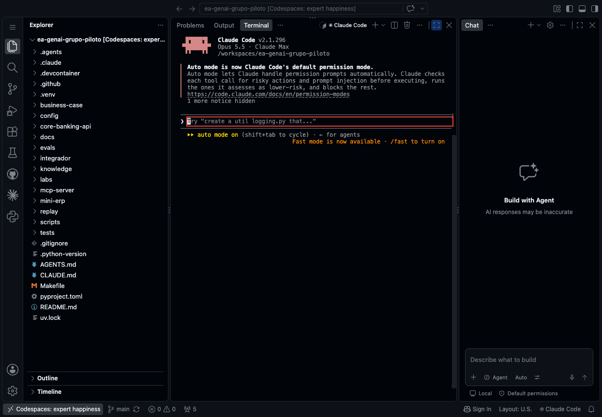

De volta ao terminal, rode `make check`. Agora o esperado é **PASS: 4 ok, 0 aviso(s), 0 falha(s)**.
Pronto: o ambiente está configurado. O login fica guardado no Codespace.

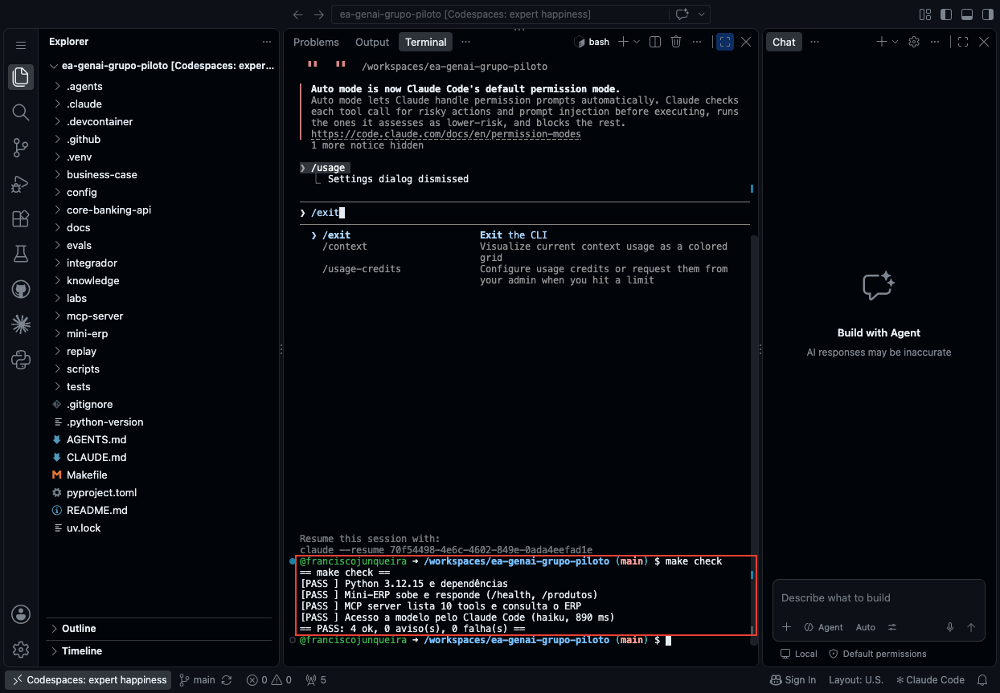

## 6. Rodar o primeiro exercício (Lab 1, na aula)

No explorador, abra `labs` → `lab1` e clique em **README.md (1)**: ele abre já formatado. É o
roteiro do lab.

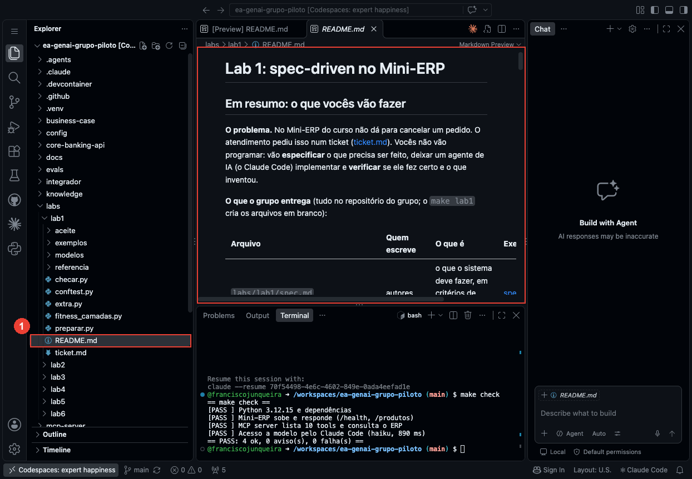

No terminal:

```bash
make lab1
make lab1-check
```

O esperado é `[OK] 1. Lab preparado`, os demais itens com `[FALHA]` e a explicação de cada um, e no
fim `lab1-check: FAIL (1/7 itens)`. **Esse FAIL é o ponto de partida**, não um erro. A última linha,
`make: *** [...] Error 1`, também é normal: é como o `make` avisa que o check deu FAIL.

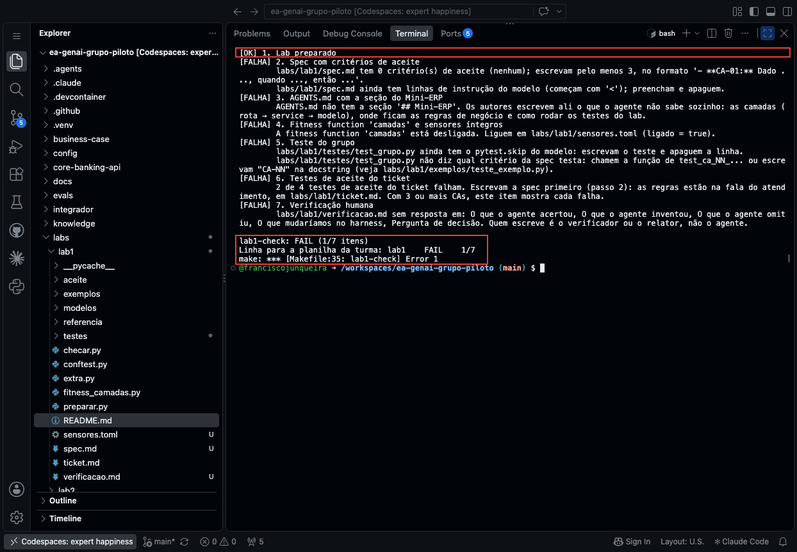

A partir daqui, siga o README do lab.

## 9. Parar o Codespace ao terminar

Fechar a aba **não** para o Codespace: ele continua gastando a sua cota gratuita por até 30 minutos.
Para parar, entre em https://github.com/codespaces e clique no **⋯ (1)** ao lado do Codespace.

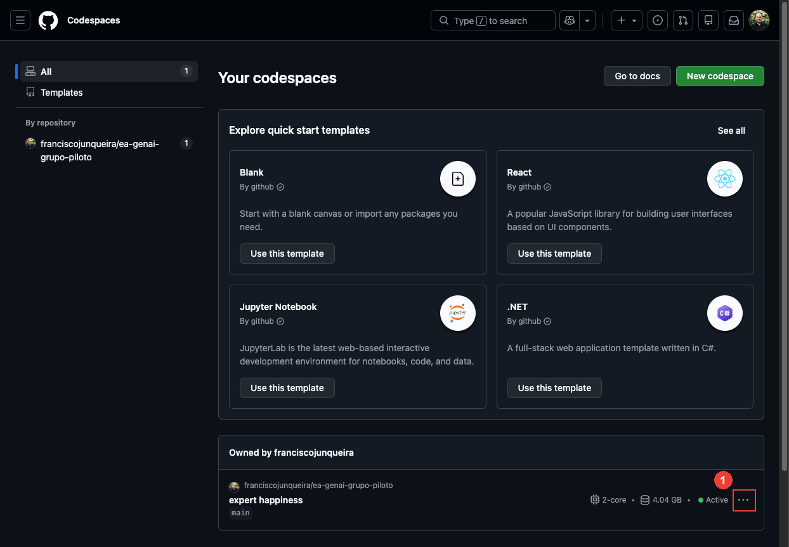

Clique em **Stop codespace (2)**. **Nunca** clique em *Delete* (amarelo): apaga o Codespace com o
login e com o que não foi enviado ao repositório.

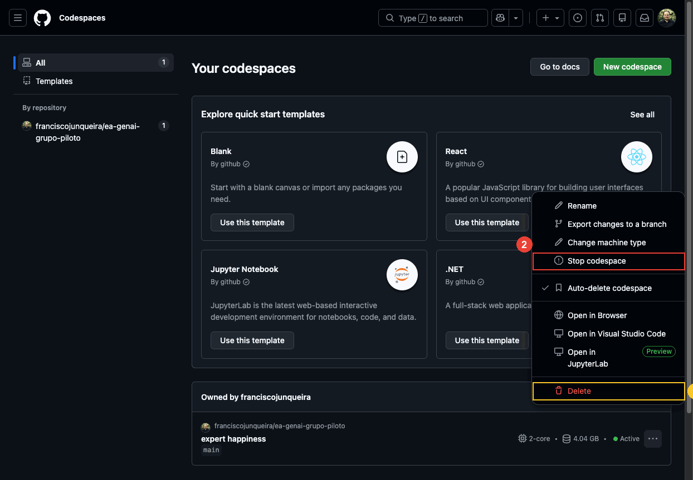

No dia da aula, volte pelo mesmo caminho (**Code → Codespaces**) e clique no Codespace que **já
existe**. Não crie outro.

## Deu errado?

| O que aparece | O que fazer |
|---|---|
| Editor em *Restricted Mode*, sem terminal | Clique em **Trust Folder & Continue** (ou no aviso azul do topo, **Manage → Trust**) |
| O terminal não mostra o `make check` | Normal. Clique no terminal, digite `make check` e Enter |
| *localhost refused to connect* no navegador | Feche a aba. Volte ao terminal e use Cmd/Ctrl+clique no link (passo 5) |
| O Claude Code fechou logo depois do login | Você deu Enter em *No, exit*. Rode `claude` de novo e escolha **Yes, I trust this folder** |
| Autorizei com a conta errada | No Claude Code, digite `/logout`, depois `/login`, e confira o e-mail antes de autorizar |
| Não acho a aba **Ports** | Feche o painel Chat à direita ou procure no menu **⋯** da barra do terminal |
| Mais casos | [FAQ do repositório](faq.md) |
