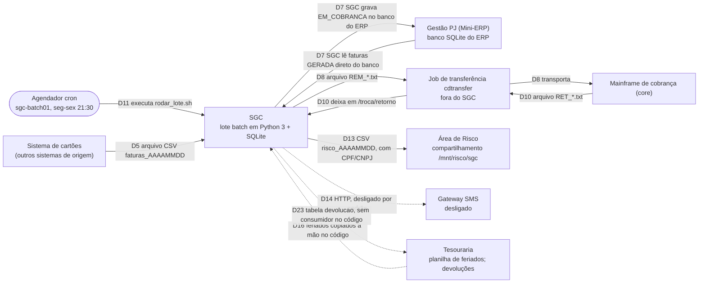
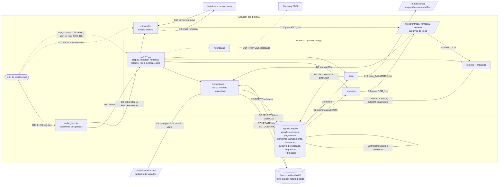

# C4 do SGC (saída de um agente, 08/11/2026; pode conter erros)

<!-- Atividade 1. Dois diagramas Mermaid: contexto (nível 1) e containers (nível 2).
Mostrem o que o código faz, não o que a documentação diz. Toda seta precisa de evidência
em dependencias.md. O `make er-check` exige os dois blocos mermaid. ATENÇÃO: este arquivo foi gerado por um agente (Claude Sonnet) em 08/11/2026 e pode conter erros. Os números de linha que o texto cita são deste arquivo, como está. -->

Convenção: `D<n>` na seta aponta para a linha `n` de [dependencias.md](dependencias.md), onde está a
evidência `arquivo:linha` (relativa a `integrador/legado/`). Linha cheia = **fato** (lido no código ou
visto ao rodar `make legado`). Linha tracejada = **inferência** ou integração desligada/sem uso.

## Contexto

Fatos que sustentam o desenho: o SGC não expõe API; as entradas e saídas são CLI, arquivos e o banco
SQLite (`sgc/__main__.py:14-40`, `sgc/config.py:12-17`). A ligação direta com o mainframe
(`MAINFRAME_HOST`/`MAINFRAME_PORTA`, `sgc/config.py:28-29`) está definida mas nenhum código a usa
(busca por `MAINFRAME_` no legado só acha a definição): por isso o mainframe só fala com o SGC por
arquivos, via `cdtransfer` (`ops/rodar_lote.sh:18`, `ops/crontab.txt:4`).

## Containers

Observações sobre o diagrama (fato, salvo onde indicado):

- Todo o SGC é **um único processo Python de execução curta** (não há daemon nem servidor): cada
  etapa é uma invocação de linha de comando que abre o SQLite, trabalha e fecha
  (`sgc/__main__.py:22-39`). Não há porta de rede aberta.
- O passo `notificar` existe no CLI (`sgc/__main__.py:37-38`) mas **o lote de produção não o chama**
  (`ops/rodar_lote.sh:14-19`), e a notificação está desligada por padrão (`sgc/config.py:48`).
  Por isso a seta está tracejada.
- O lote de produção também **não usa `ciclo`**, que é o comando que o README manda rodar
  (`README.md:15`): ele encadeia `retorno`, dois `importar`, `remessa`, `cdtransfer` e `risco`
  (`ops/rodar_lote.sh:14-19`).
- A seta tracejada do cron do dia 1 é **inferência**: a linha `ops/crontab.txt:6` roda
  `python3 -m sgc risco` sem `cd /opt/sgc` e sem exportar `SGC_DB`, ao contrário do lote
  (`ops/rodar_lote.sh:4-11`). Não rodamos o crontab, então não sabemos se o `-m sgc` resolve o
  pacote nem em qual banco ele grava.
- `cdtransfer` não está no repositório: o que ele faz com os arquivos já enviados é **não encontrado**.

## O que mudou em relação ao fluxo descrito em caso.md

- **Gestão PJ não entra por CSV.** O caso diz "arquivo CSV" (`../caso.md:23`). O código lê
  as faturas direto do banco do ERP e **escreve de volta** nele (`fatura.status` passa de `GERADA`
  para `EM_COBRANCA`) — `sgc/importacao.py:85-101`; o lote usa essa origem (`ops/rodar_lote.sh:15`).
  O CSV de exemplo também traz faturas `GESTAOPJ` (`dados/entrada/faturas_20261125.csv:2`) e o lote
  roda os dois caminhos (`ops/rodar_lote.sh:15-16`). **Inferência:** a mesma fatura pode chegar por
  duas vias; não há deduplicação por `origem_id` (`sgc/banco.py:21-34`, só `nosso_numero` é único).
- **Não há registro online no core.** O README diz que o SGC registra boletos "pelo SGC-WS
  (webservice SOAP)" (`README.md:20`). **Não encontrado:** nenhuma chamada SOAP, cliente HTTP para o
  core ou biblioteca para isso em todo o legado. O registro acontece só pelo arquivo de remessa
  (`sgc/remessa.py:53-81`) e pela confirmação no retorno (ocorrência 02, `sgc/retorno.py:59-61`).
- **O transporte dos arquivos é um terceiro componente**, o `cdtransfer`, fora do SGC e sem código
  no repositório (`ops/rodar_lote.sh:18`, `ops/crontab.txt:4`; `sgc/config.py:14`). O caso desenha
  setas diretas SGC↔mainframe.
- **O retorno chega de manhã e é processado à noite.** O `cdtransfer` busca o retorno às 05:30
  (`ops/crontab.txt:4`) e o lote o processa às 21:30 (`ops/crontab.txt:3`, `ops/rodar_lote.sh:14`).
- **O banco é SQLite, não Oracle.** README fala em Oracle 11g e tabelas `SGC_*` (`README.md:11`); o
  código usa SQLite (`sgc/banco.py:2,99`) e as tabelas têm outros nomes (`sgc/banco.py:9-69`).
  A linguagem é Python 3, não 2.7 (`README.md:10`; `sgc/config.py:6`, `sgc/importacao.py:17`).
- **A Risco recebe um arquivo, não um relatório "consultável".** CSV diário em um compartilhamento de
  rede (`sgc/config.py:21`, `sgc/risco.py:64`), com documento e nome do sacado (`sgc/risco.py:68`).
  Se o compartilhamento falhar, o relatório cai em silêncio numa pasta local (`sgc/risco.py:42-50`).
- **O mesmo passo do relatório também grava no banco.** No dia 1 do mês, `risco` baixa cobranças com
  mais de 180 dias de atraso (`sgc/risco.py:54-56,29-39`). O caso só descreve um "relatório diário".
- **Existem fluxos que o caso não mostra:** a tabela `devolucao` alimentada por trigger
  (`sgc/banco.py:85-90`, pedido da Tesouraria; nada no código lê a tabela), o acúmulo de faturas
  abaixo de R$ 10 (`sgc/importacao.py:51-57`) e o aviso por SMS desligado (`sgc/notificacao.py:3`).
- **Volumes do caso** (38 mil boletos/dia, 1,1 milhão em aberto, `../caso.md:30`): não é possível
  confirmar pelo código nem pelos dados de exemplo (26 faturas). **Inferência:** não há índice em
  `cobranca.status` nem em `sacado.nome_normalizado` (`sgc/banco.py:9-34`), então consultas por esses
  campos fazem varredura completa em 1,1 milhão de linhas.
