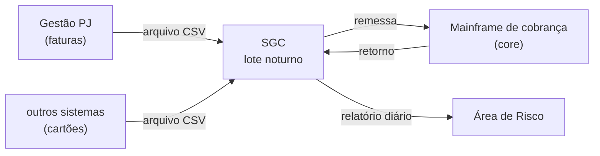

# Caso integrador: o assistente Bússola na TechCorp

Todos os nomes, pessoas, volumes e documentos deste caso são **fictícios**. Os números de volume e
orçamento são **dados do caso**: usem como premissa e citem como "caso.md". A regulação citada é
real e foi conferida em 12/10/2026; normas mudam, então confiram a data no Radar do curso.

## 1. A instituição

A **TechCorp Banco Múltiplo S.A.** é um banco médio, digital, autorizado e supervisionado pelo
Banco Central do Brasil. Tem cerca de 3.200 colaboradores e opera:

| Sistema | O que é | Onde está no repositório |
|---|---|---|
| Plataforma digital | 47 microsserviços em 3 domínios (pagamentos, onboarding, crédito) | documentos em `knowledge/techcorp/` |
| Core de pagamentos | API de pagamentos e saldos, mantida pelo squad de Pagamentos | `core-banking-api/` |
| **Gestão PJ** | ERP de vendas e faturamento que o banco oferece a 12 mil clientes pessoa jurídica (o Mini-ERP) | `mini-erp/`, `mcp-server/` |
| **SGC** | Sistema de Gestão de Cobrança, de 2011: emite os boletos das faturas e concilia os pagamentos num lote noturno | `integrador/legado/` |

O fluxo como a TI o descreve hoje, sem verificação (vocês vão conferir na engenharia reversa):

Volumes do SGC (dados do caso): cerca de 38 mil boletos emitidos por dia útil, 1,1 milhão de
boletos em aberto e um relatório de inadimplência diário com cerca de 60 mil linhas.

## 2. O problema

Três áreas gastam tempo procurando informação que já existe, mas está espalhada:

- **Arquitetura** responde, em reuniões e chats, como os sistemas funcionam e por que foram
  decididos assim. Os ADRs estão em repositórios diferentes, e o SGC não tem documentação confiável.
- **Risco** depende do relatório CSV diário do SGC e de planilhas. Quando um número parece
  estranho, abre chamado para a TI e espera dias.
- **TI Operacional** atende o plantão 24×7. Consulta runbooks e, quando o lote do SGC falha,
  investiga o banco do SGC à mão.

A diretoria aprovou um piloto de assistente interno com IA generativa, o **Bússola**, com três
capacidades:

1. **Responder com fonte**: perguntas sobre sistemas, decisões, procedimentos e carteira de
   cobrança, sempre citando de onde veio a resposta e respeitando o que cada área pode ver.
2. **Consultar sistemas**: ler dados do SGC, do Gestão PJ e do core por ferramentas (MCP).
3. **Agir com aprovação**: executar poucas operações de escrita (por exemplo, reprocessar um
   arquivo de retorno do SGC ou registrar um alerta no Gestão PJ), sempre com aprovação humana.

O projeto integrador de cada grupo é **a arquitetura do Bússola**: decisões, design, qualidade,
economia e segurança, defendidos na Aula 4.

## 3. Os três departamentos

| Departamento | Usuários | Dados que o Bússola usa | Sensibilidade | Uso estimado (dado do caso) |
|---|---|---|---|---|
| Arquitetura | 45 arquitetos e tech leads | ADRs, documentos de arquitetura, repositórios de código (inclui o `core-banking-api`) | **Interno** | 10 consultas por pessoa por dia útil |
| Risco | 30 analistas | relatório de inadimplência do SGC (com CPF, CNPJ e nome), parâmetros de provisão | **Regulado** | 15 consultas por pessoa por dia útil |
| TI Operacional | 180 analistas N1/N2, 24×7 | runbooks, FAQs, status do lote do SGC, Gestão PJ | **Público** (runbooks e FAQs) e Interno (status de sistemas) | 20 consultas por pessoa por dia útil (fins de semana fora da estimativa) |

Regra de acesso: cada usuário vê o próprio nível e os níveis menos sensíveis (Público < Interno <
Regulado), salvo exceção registrada. Um analista de TI Operacional não vê o relatório do Risco.

**Cenários de volume** para o business case (Lab 5):

| Cenário | Quem usa | Consultas por dia útil (aprox.) |
|---|---|---|
| Piloto | só Arquitetura | 450 |
| Alvo | os três departamentos | 4.500 |
| Expansão | alvo + atendimento ao cliente PJ pelo Gestão PJ (usuários externos) | 25.000 |

## 4. Requisitos e restrições do caso

Citem os IDs (RC-NN) na tabela de requisitos dos ADRs e na rastreabilidade.

| ID | Requisito ou restrição | Origem |
|---|---|---|
| RC-01 | Toda resposta cita a fonte (documento e trecho, ou consulta e parâmetros) | Risco e Auditoria Interna |
| RC-02 | Permissão por departamento e por documento, conforme a regra de acesso da seção 3 | Segurança da Informação |
| RC-03 | Dados pessoais de clientes (CPF, CNPJ, nome, telefone) só são processados em região no Brasil | Política interna de dados da TechCorp (mais restrita que a LGPD) |
| RC-04 | Escrita em sistema (SGC, Gestão PJ) só com aprovação humana registrada; nenhuma escrita no core de pagamentos nem no mainframe de cobrança | Comitê de Riscos Operacionais |
| RC-05 | Trilha de auditoria de cada interação (usuário, pergunta, fontes, ferramentas chamadas, modelo, custo), retida por 5 anos | Auditoria Interna |
| RC-06 | Latência p95: até 8 s para TI Operacional; até 30 s para análises do Risco | TI Operacional e Risco |
| RC-07 | Disponibilidade: horário comercial para Arquitetura e Risco; 24×7 para TI Operacional, aceitando modo degradado (só busca, sem geração) | TI Operacional |
| RC-08 | Orçamento de até R$ 35 mil por mês no cenário alvo (modelos, infraestrutura e observabilidade; pessoas fora) | Diretoria Financeira |
| RC-09 | O lote noturno do SGC (21:30–23:00, dias úteis) não pode ser afetado | TI Operacional |
| RC-10 | Equipe da plataforma: 4 engenheiros, sem time dedicado de MLOps | Diretoria de Tecnologia |
| RC-11 | Piloto em produção em 4 meses | Diretoria |
| RC-12 | O Bússola não toma nem recomenda decisão de crédito ou de provisão: informa, com fonte | Risco e Jurídico |

O que o SGC expõe de fato (API, banco, arquivos) é o que vocês descobrirem na engenharia reversa.
Não presumam uma API que não encontrarem.

## 5. Regulação que vira requisito arquitetural

Conferido em 12/10/2026 nas fontes indicadas. Este curso trata a regulação como **requisito de
arquitetura**; programa de compliance e comitês são tema do curso de Governança de IA.

| Norma | O que importa para o Bússola | Fonte |
|---|---|---|
| LGPD (Lei 13.709/2018) | base legal, minimização, direitos do titular; transferência internacional só nas hipóteses da lei, por exemplo cláusulas-padrão da Res. CD/ANPD 19/2024 | planalto.gov.br/ccivil_03/_ato2015-2018/2018/lei/l13709.htm · gov.br/anpd |
| Res. CMN 4.893/2021, alterada pela Res. CMN 5.274/2025 | política de segurança cibernética; contratar serviço relevante de processamento, armazenamento ou nuvem exige diligência prévia e comunicação ao BCB em até 10 dias após a contratação (art. 15); serviço prestado no exterior exige convênio entre o BCB e o supervisor do país ou, sem convênio, pedido de autorização ao BCB com 60 dias de antecedência (art. 16) | bcb.gov.br/estabilidadefinanceira/buscanormas |
| Res. CMN 4.966/2021 | instrumentos financeiros e provisão para perdas esperadas, vigente desde 01/01/2025 | bcb.gov.br/estabilidadefinanceira/buscanormas |
| PL 2338/2023 (marco da IA) | em tramitação na Câmara; não é lei. Usar como tendência, não como obrigação | camara.leg.br (proposição 2487262) |
| EU AI Act | a TechCorp não opera na União Europeia: não se aplica diretamente. Referência de classificação por risco (avaliação de crédito de pessoa física é alto risco, Anexo III) | digital-strategy.ec.europa.eu/en/policies/regulatory-framework-ai |

Não há, em 12/10/2026, norma do BCB específica sobre IA generativa em instituições financeiras:
valem as regras gerais acima.

## 6. O que fica fora

- Decisão automática de crédito ou de provisão (RC-12).
- Treinar ou ajustar modelo com dados de clientes.
- Atendimento ao cliente final, exceto no cenário de expansão, que só entra no business case.
