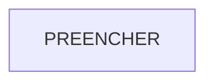

# Design do Bússola

<!-- Critério "Design" da rubrica (15 pts). As seções "Decisão de conhecimento" e
"Contrato MCP" entram no checkpoint (Atividade 2); o resto, no pacote final. -->

## Visão geral

<!-- C4 de contexto e de containers do Bússola, em Mermaid: usuários dos 3 departamentos,
Bússola, modelos, fontes de conhecimento, SGC, Gestão PJ, core. Mostrem onde ficam o
gateway, a checagem de permissão e a trilha de auditoria. -->

## Decisão de conhecimento

<!-- Contexto longo, RAG, busca agêntica ou ferramentas: o que vocês usam para cada tipo de
pergunta e departamento, e por quê. Usem os dados do Lab 2 (a linha de métricas do grupo e a
planilha da turma) e digam como a permissão por documento (RC-02) é aplicada. -->

PREENCHER

## Contrato MCP

<!-- Uma linha por ferramenta, com o nome completo Servidor:ferramenta. Partam do MCP do
Lab 3 e acrescentem o acesso ao SGC que a engenharia reversa mostrou ser viável.
"Idempotente": rodar duas vezes dá o mesmo resultado? Se não, como vocês protegem? -->

| Servidor:ferramenta | Lê ou escreve | Entrada | Saída | Aprovação humana | Idempotente | Departamentos |
|---|---|---|---|---|---|---|
| PREENCHER | PREENCHER | PREENCHER | PREENCHER | PREENCHER | PREENCHER | PREENCHER |

## Decisões registradas

<!-- Links para os ADRs em docs/adr/ e uma frase sobre cada um. -->

- PREENCHER
