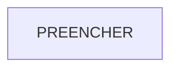

# C4 do SGC

<!-- Atividade 1. Dois diagramas Mermaid: contexto (nível 1) e containers (nível 2).
Mostrem o que o código faz, não o que a documentação diz. Toda seta precisa de evidência
em dependencias.md. O `make er-check` exige os dois blocos mermaid. -->

## Contexto

## Containers

## O que mudou em relação ao fluxo descrito em caso.md

- PREENCHER
